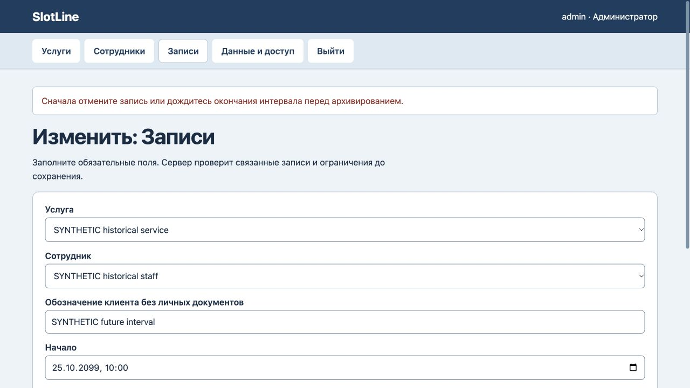
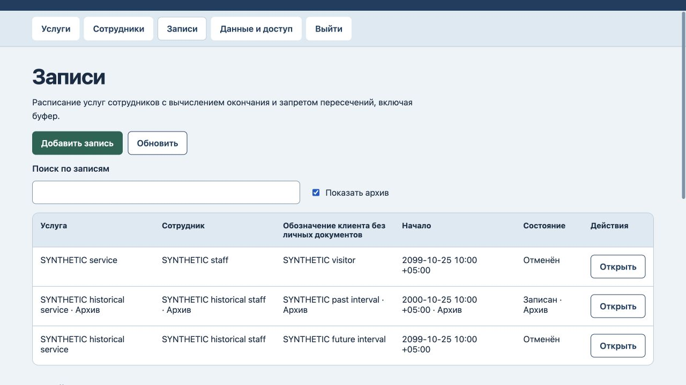

# SlotLine: история и архив

24 октября2026. На прежнем коде воспроизведены два сбоя: отменённая запись мешала архивировать сотрудника/услугу, а будущую активную запись можно было спрятать в архиве, сохранив занятый интервал. Обе регрессионные проверки сначала завершились ошибкой.

Теперь будущую или идущую активную запись нельзя архивировать до её окончания с буфером: сначала отмена либо окончание интервала по часам сервера. После отмены или окончания ресурсы архивируются, а запись, её ссылки, начало и рассчитанный конец сохраняются. Прошедший интервал остаётся со своим статусом; это не подтверждение фактического проведения встречи.

Старые архивные активные записи не переписываются автоматически и не блокируют несвязанные изменения. Они остаются доступны через «Показать архив» и продолжают участвовать в проверке пересечений. Импорт старой копии сохраняет эти записи; новые архивы активных интервалов запрещены.

Все7 тестов прошли: отмена/архив, будущий интервал, прошедшая история, совместимость старых архивов, запрет повторного бронирования архивных ресурсов, файловый перезапуск и восстановление. Исходный сценарий пересечения с буфером также сохраняется.

В браузере на синтетических данных отказ архивирования будущей записи сохранил весь payload, версию10 и10 записей журнала. После отмены ресурсы архивированы; прошлый интервал отдельно архивирован с исходным статусом и временем10:00–11:15+05. Итоговая версия14 и14 записей журнала. После обновления страницы история прочитана повторно. [Машинная запись](archival-verification.json).

Проверены предметное правило и сообщение отказа. Разметка, схема хранения, внешние интеграции, уведомления и платежи не добавлялись. Сервер проверен локально; клиентская приёмка и внешний аудит не заявлены.
